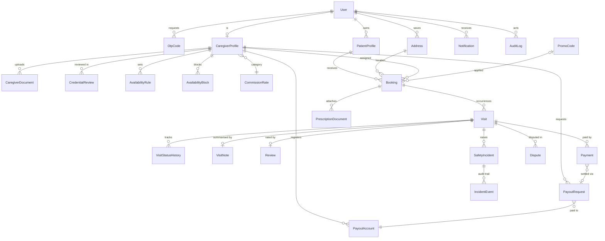

# CareSaath — Entity Relationship Document (ERD)

**Source:** CareSaath SRS (Sep 23, 2026)
**Database:** PostgreSQL via Prisma ORM
**Scope:** MVP, 1–2 pilot cities. Every entity traces to an SRS requirement. Anything the SRS does not specify is marked **TBD**; design choices made only to implement an SRS requirement are marked **(design)**.

---

## 1. Conventions

- Primary keys: `id` (UUID) on every table (design).
- Timestamps: `createdAt`, `updatedAt` on every table (design); extra timestamps listed per table.
- Soft delete / deactivation uses a `status` field, not row deletion (needed for the audit requirement in SRS §6).
- Files (prescriptions, licenses, certificates, photos) are stored in MinIO. The database stores only the object key, never the file.
- Money: stored as integer minor units. **Currency PKR assumed; confirm (TBD).**
- Enums are listed in section 4.

---

## 2. ER Diagram

---

## 3. Entities

### 3.1 Identity and access

#### User  — FR-C1, FR-CG1, FR-A1
| Field | Type | Notes |
|---|---|---|
| id | UUID PK | |
| phone | String, unique | Login identifier (FR-C1) |
| role | Enum `UserRole` | CUSTOMER, CAREGIVER, ADMIN |
| fullName | String | |
| preferredLanguage | Enum `Language` | EN / UR (SRS §2.5, §6) |
| status | Enum `UserStatus` | ACTIVE, SUSPENDED, DEACTIVATED (FR-A3) |
| lastLoginAt | DateTime? | |

Admin login method: **TBD** (SRS specifies OTP login only for customers; use case table shows admin "Register/Login: Yes").

#### OtpCode  — FR-C1, FR-CG7
| Field | Type | Notes |
|---|---|---|
| id | UUID PK | |
| userId | FK → User? | Null before first registration |
| phone | String | |
| codeHash | String | Never store the plain OTP (design) |
| purpose | Enum `OtpPurpose` | LOGIN, VISIT_CHECKIN (FR-CG7 allows "GPS or OTP confirmation") |
| visitId | FK → Visit? | Used when purpose = VISIT_CHECKIN |
| expiresAt | DateTime | Expiry duration: **TBD** |
| consumedAt | DateTime? | |
| attempts | Int | Max attempts: **TBD** |

Primary OTP store is Redis for speed (see TRD). This table is the durable record.

#### EmergencyContact  — SRS §9.2 (SOS alerts "an emergency contact")
| Field | Type | Notes |
|---|---|---|
| id | UUID PK | |
| userId | FK → User | |
| name | String | |
| phone | String | |

SRS does not say whose emergency contact is alerted (customer's, patient's, or caregiver's). **TBD.** Modeled on User for now.

---

### 3.2 Customer side

#### PatientProfile  — FR-C2
| Field | Type | Notes |
|---|---|---|
| id | UUID PK | |
| ownerUserId | FK → User | The customer who manages it |
| name | String | |
| relationship | Enum `PatientRelation` | SELF, FAMILY_MEMBER |
| dateOfBirth / age | Date? | **TBD** — SRS says only "basic medical context" |
| gender | String? | **TBD** |
| medicalContext | Text? | "Basic medical context" (FR-C2). Exact fields **TBD**. Sensitive: encrypted (SRS §6) |

#### Address  — FR-C7
| Field | Type | Notes |
|---|---|---|
| id | UUID PK | |
| userId | FK → User | |
| label | String? | |
| addressLine | String | |
| city | String | Pilot cities: **TBD** |
| latitude, longitude | Decimal | Map pin (FR-C7) |

---

### 3.3 Caregiver side

#### CaregiverProfile  — FR-CG1, FR-CG2, FR-CG3, FR-C4
| Field | Type | Notes |
|---|---|---|
| id | UUID PK | |
| userId | FK → User, unique | |
| cnic | String | Required at registration (FR-CG1). Sensitive: encrypted |
| licenseNumber | String | Shown to customers (FR-C4) |
| licenseBody | Enum `LicenseBody` | PNC, PMDC, OTHER (SRS §1.4, §9.1, §7.5). Physiotherapy body name **TBD** |
| specialty | Enum `Specialty` | See section 4 |
| experienceYears | Int? | Shown on profile (FR-C4). Capture method **TBD** |
| bio | Text? | **TBD** — not in SRS, remove if not wanted |
| photoKey | String | Shown to customer before visit (SRS §9.2) |
| serviceArea | String / Json | FR-CG3. Representation (city list vs radius vs polygon) **TBD** |
| ratePerVisit | Int | FR-CG3 |
| commissionRateId | FK → CommissionRate | Category-level commission (FR-A4) |
| verificationStatus | Enum `VerificationStatus` | PENDING, APPROVED, REJECTED, SUSPENDED |
| approvedAt | DateTime? | |
| reverifyDueAt | DateTime? | Periodic re-verification, e.g. annually (FR-A2) |
| ratingAverage | Decimal | Derived from Review (design, denormalised for the 3 s search target) |
| ratingCount | Int | Same |

Rule: a caregiver is returned by search only when `verificationStatus = APPROVED` and the linked `User.status = ACTIVE` (SRS §2.5).

#### CaregiverDocument  — FR-CG1
| Field | Type | Notes |
|---|---|---|
| id | UUID PK | |
| caregiverId | FK → CaregiverProfile | |
| type | Enum `DocType` | LICENSE, CERTIFICATE, CNIC_COPY?, OTHER. CNIC copy upload **TBD** (SRS lists CNIC number only) |
| fileKey | String | MinIO object key |
| mimeType, sizeBytes | String, Int | |

#### CredentialReview  — FR-A1, FR-A2, SRS §6 Auditability
| Field | Type | Notes |
|---|---|---|
| id | UUID PK | |
| caregiverId | FK → CaregiverProfile | |
| reviewerId | FK → User (admin) | |
| kind | Enum | INITIAL, PERIODIC |
| decision | Enum | APPROVED, REJECTED |
| reason | Text? | Rejection reason |
| decidedAt | DateTime | |

#### AvailabilityRule  — FR-CG4 (weekly availability)
| Field | Type | Notes |
|---|---|---|
| id | UUID PK | |
| caregiverId | FK | |
| dayOfWeek | Int 0–6 | |
| startTime, endTime | Time | |

#### AvailabilityBlock  — FR-CG4 (blocked dates)
| Field | Type | Notes |
|---|---|---|
| id | UUID PK | |
| caregiverId | FK | |
| startDate, endDate | Date | |
| reason | String? | |

---

### 3.4 Booking and visit

SRS FR-C6 allows "a single visit or a recurring schedule (e.g., daily for 2 weeks)", while the visit lifecycle (SRS §8.2) and check-in/out (FR-CG7) apply per visit. **(design)** A `Booking` holds the request; each occurrence is a `Visit`. A single visit is a Booking with one Visit.

#### Booking  — FR-C3, C5, C6, C7, C13
| Field | Type | Notes |
|---|---|---|
| id | UUID PK | |
| customerId | FK → User | |
| patientId | FK → PatientProfile | |
| caregiverId | FK → CaregiverProfile | |
| addressId | FK → Address | |
| type | Enum `BookingType` | SINGLE, RECURRING |
| recurrenceRule | Json? | e.g. daily for 2 weeks. Allowed patterns **TBD** |
| startDate, endDate | Date | |
| timeWindowStart, timeWindowEnd | Time | FR-C7 "time window" |
| serviceType | Enum `Specialty` | |
| rateSnapshot | Int | Rate at time of booking (design) |
| promoCodeId | FK → PromoCode? | FR-A8 |
| discountAmount | Int | |
| status | Enum `BookingStatus` | REQUESTED, CONFIRMED, DECLINED, CANCELLED, COMPLETED |
| respondBy | DateTime | Caregiver accept/decline deadline (FR-CG5). Window length **TBD** |
| cancelledAt, cancelledBy, cancelReason | DateTime?, FK?, Text? | FR-C13 |

#### Visit  — FR-C9, FR-CG7, SRS §8.2
| Field | Type | Notes |
|---|---|---|
| id | UUID PK | |
| bookingId | FK → Booking | |
| scheduledDate | Date | |
| timeWindowStart, timeWindowEnd | Time | |
| status | Enum `VisitStatus` | See section 4 |
| enRouteAt | DateTime? | |
| checkInAt, checkOutAt | DateTime? | |
| checkInMethod, checkOutMethod | Enum `CheckMethod`? | GPS, OTP (FR-CG7) |
| checkInLat/Lng, checkOutLat/Lng | Decimal? | SRS §7.4 location capture |
| rescheduledFromId | FK → Visit? | FR-C13 |

#### VisitStatusHistory  — FR-C9, FR-C10, SRS §6 Auditability
| Field | Type | Notes |
|---|---|---|
| id | UUID PK | |
| visitId | FK | |
| fromStatus, toStatus | Enum | |
| actorId | FK → User? | Null for system transitions |
| at | DateTime | |

#### PrescriptionDocument  — FR-C5, FR-CG6
| Field | Type | Notes |
|---|---|---|
| id | UUID PK | |
| bookingId | FK → Booking | |
| uploadedById | FK → User | |
| fileKey | String | MinIO key; access limited to assigned caregiver and admin (SRS §6) |
| mimeType, sizeBytes | String, Int | Allowed types/size **TBD** |

#### VisitNote  — FR-CG8, FR-C11
| Field | Type | Notes |
|---|---|---|
| id | UUID PK | |
| visitId | FK → Visit, unique | |
| caregiverId | FK | |
| summary | Text | "Brief visit note/summary" |
| submittedAt | DateTime | Submission moves visit CheckedOut → Completed (SRS §8.2) |

#### Review  — FR-C12
| Field | Type | Notes |
|---|---|---|
| id | UUID PK | |
| visitId | FK → Visit, unique | Only after a completed visit |
| customerId | FK | |
| caregiverId | FK | |
| rating | Int | Scale (1–5 assumed) **TBD** |
| comment | Text? | |

---

### 3.5 Payments and payouts

#### Payment  — FR-C8, FR-A4, SRS §7.2
| Field | Type | Notes |
|---|---|---|
| id | UUID PK | |
| visitId | FK → Visit | Payment level (per visit vs per booking) **TBD** |
| method | Enum `PaymentMethod` | CASH, CARD, JAZZCASH, EASYPAISA |
| status | Enum `PaymentStatus` | PENDING, PAID, FAILED, REFUNDED (refund flow **TBD**) |
| amount | Int | |
| commissionAmount | Int | Platform share (SRS §9.4 glossary) |
| caregiverAmount | Int | |
| gatewayRef | String? | Gateway transaction id |
| paidAt | DateTime? | |
| payoutRequestId | FK → PayoutRequest? | |

Cash on visit: how commission is collected from the caregiver is **TBD** (SRS §2.5 requires cash payment but does not describe settlement).

#### PayoutAccount  — FR-CG9
| Field | Type | Notes |
|---|---|---|
| id | UUID PK | |
| caregiverId | FK | |
| type | Enum | BANK, MOBILE_WALLET |
| provider | String | Bank/wallet name |
| accountTitle | String | |
| accountNumber | String | Encrypted |

#### PayoutRequest  — FR-CG9
| Field | Type | Notes |
|---|---|---|
| id | UUID PK | |
| caregiverId | FK | |
| payoutAccountId | FK | |
| amount | Int | |
| status | Enum | REQUESTED, PROCESSING, PAID, REJECTED. Approval flow **TBD** |
| requestedAt, processedAt | DateTime | |

Raast is named in SRS §7.2 for bank-to-bank transfers; whether it is used for payouts, customer payments, or both is **TBD**.

#### CommissionRate  — FR-A4
| Field | Type | Notes |
|---|---|---|
| id | UUID PK | |
| category | Enum `Specialty` | Rate is configured per caregiver category |
| percentage | Decimal | Value **TBD** |
| effectiveFrom | DateTime | (design) so past payments keep the rate they used |

#### PromoCode  — FR-A8
| Field | Type | Notes |
|---|---|---|
| id | UUID PK | |
| code | String, unique | |
| discountType | Enum | PERCENT, FIXED. Types **TBD** |
| discountValue | Int | |
| validFrom, validTo | DateTime | |
| maxUses | Int? | **TBD** |
| active | Boolean | |

SRS also mentions "platform-wide discounts"; whether these are separate from promo codes is **TBD**.

---

### 3.6 Safety, disputes, notifications, audit

#### SafetyIncident  — FR-C14, FR-CG10, FR-A6, SRS §9.2
| Field | Type | Notes |
|---|---|---|
| id | UUID PK | |
| visitId | FK → Visit? | FR-C14 ties it to a visit; FR-CG10 "at a patient's home" |
| reportedById | FK → User | |
| source | Enum | CUSTOMER_COMPLAINT, CAREGIVER_REPORT, SOS |
| description | Text | |
| priority | Enum | Levels **TBD** (SRS: "priority escalation") |
| status | Enum | OPEN, IN_REVIEW, RESOLVED |
| assignedAdminId | FK → User? | |
| resolvedAt | DateTime? | |

#### IncidentEvent  — FR-A6 (audit trail)
| Field | Type | Notes |
|---|---|---|
| id | UUID PK | |
| incidentId | FK | |
| actorId | FK → User | |
| action | String | |
| note | Text? | |
| at | DateTime | |

#### Dispute  — FR-A7
| Field | Type | Notes |
|---|---|---|
| id | UUID PK | |
| visitId | FK | |
| raisedById | FK → User | |
| againstUserId | FK → User | |
| description | Text | |
| status | Enum | OPEN, RESOLVED. Statuses and who may raise **TBD** |
| resolutionNote | Text? | |
| resolvedById | FK → User? | |

#### Notification  — FR-C10
| Field | Type | Notes |
|---|---|---|
| id | UUID PK | |
| userId | FK | |
| channel | Enum | SMS, WHATSAPP, PUSH |
| event | String | e.g. visit status change |
| payload | Json | |
| status | Enum | QUEUED, SENT, FAILED |
| sentAt | DateTime? | |

#### AuditLog  — SRS §6 Auditability
| Field | Type | Notes |
|---|---|---|
| id | UUID PK | |
| actorId | FK → User? | |
| action | String | Credential approvals, check-ins/outs, safety incidents (SRS §6) |
| entityType, entityId | String | |
| metadata | Json? | |
| at | DateTime | Timestamp + actor are the SRS minimum |

---

## 4. Enums

| Enum | Values |
|---|---|
| UserRole | CUSTOMER, CAREGIVER, ADMIN |
| UserStatus | ACTIVE, SUSPENDED, DEACTIVATED |
| Language | EN, UR |
| Specialty | NURSING, PHYSIOTHERAPY, POST_SURGERY_CARE, ELDERLY_CARE — see note |
| LicenseBody | PNC, PMDC, OTHER |
| VerificationStatus | PENDING, APPROVED, REJECTED, SUSPENDED |
| BookingType | SINGLE, RECURRING |
| BookingStatus | REQUESTED, CONFIRMED, DECLINED, CANCELLED, COMPLETED |
| VisitStatus | REQUESTED, CONFIRMED, DECLINED, CANCELLED, EN_ROUTE, CHECKED_IN, IN_PROGRESS, CHECKED_OUT, COMPLETED |
| CheckMethod | GPS, OTP |
| PaymentMethod | CASH, CARD, JAZZCASH, EASYPAISA |
| PaymentStatus | PENDING, PAID, FAILED, REFUNDED |
| NotificationChannel | SMS, WHATSAPP, PUSH |

**Specialty note:** FR-C3 lists nursing, physiotherapy, post-surgery care; FR-CG3 also lists elderly care. SRS §1.1 also mentions "attendant". Final list **TBD**.

**VisitStatus note:** SRS §8.2 has no cancelled state, yet FR-C13 allows cancellation. CANCELLED is added here as a gap-fill.

---

## 5. Key relationships and rules

1. One `User` has at most one `CaregiverProfile`; only users with role CAREGIVER have one.
2. A customer can own many `PatientProfile` rows (self + family members).
3. A `Booking` has one patient, one caregiver, one address, and one or more `Visit` rows.
4. A `Visit` has at most one `VisitNote`, one `Review`; it may have several `Payment` rows (for retries) and several `SafetyIncident` / `Dispute` rows.
5. A `Review` can exist only when the `Visit` status is COMPLETED.
6. Prescriptions and patient medical context are readable only by the customer, the assigned caregiver, and admin (SRS §6).
7. A caregiver profile is not searchable until an admin `CredentialReview` with decision APPROVED exists.

---

## 6. Indexes (suggested, design)

- `User.phone` unique
- `CaregiverProfile (verificationStatus, specialty)` and a geo or city index on service area — supports the under-3-seconds search target (SRS §6)
- `Booking (caregiverId, startDate)` and `Visit (caregiverId via booking, scheduledDate, status)` — availability conflict checks
- `Notification (userId, createdAt)`
- `AuditLog (entityType, entityId, at)`

---

## 7. Open items (TBD) affecting the data model

1. Fields inside "basic medical context" (FR-C2)
2. Service-area representation (FR-CG3) and pilot cities
3. Payment granularity (per visit vs per booking), refunds, and cash-commission settlement
4. Raast usage (customer payments, payouts, or both)
5. Whose emergency contact receives the SOS alert (§9.2)
6. Final specialty list
7. Cancellation/reschedule notice window and caregiver response window (FR-C13, FR-CG5)
8. Admin login method
9. Rating scale, review moderation
10. Recurring-schedule patterns allowed (FR-C6)
11. Dispute workflow and who may raise one
12. Data retention period for health documents
