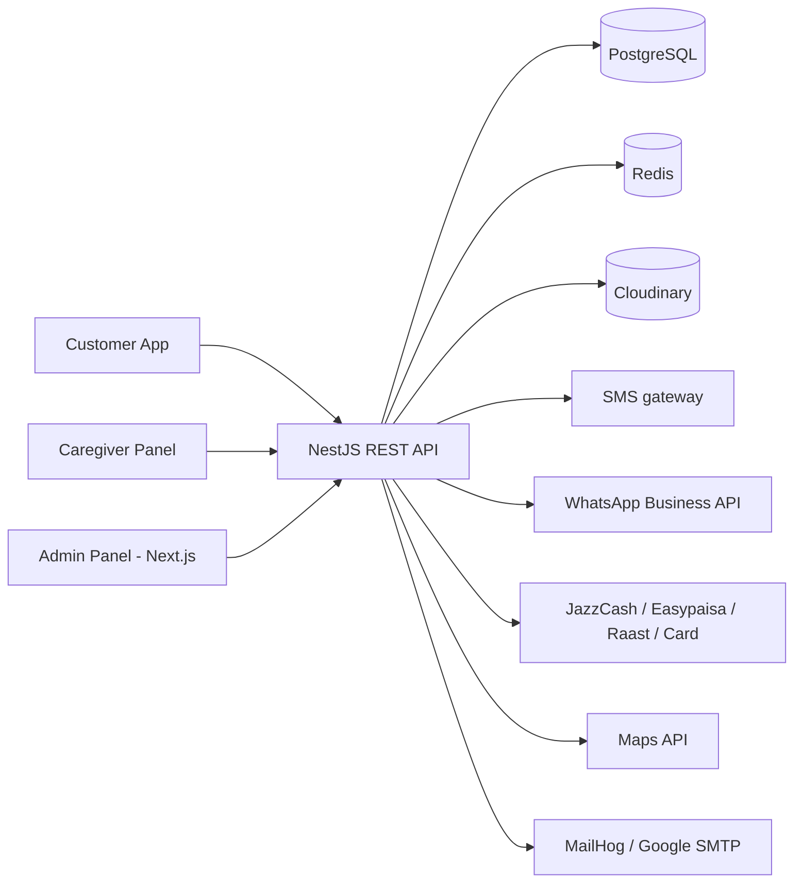
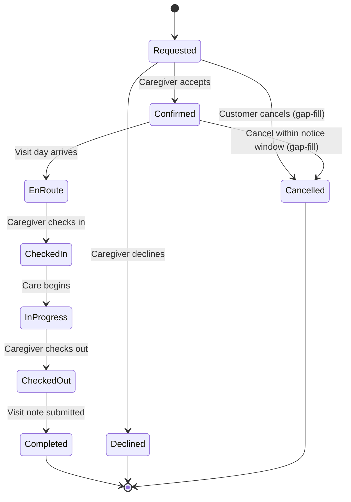

# CareSaath — Technical Requirements Document (TRD)

**Source:** CareSaath SRS (Sep 23, 2026)
**Companion docs:** CARESAATH_ERD.md, CARESAATH_TRACKER.xlsx
**Rule used:** Everything here traces to the SRS or the agreed tech stack. Unknowns are marked **TBD**. Design choices needed to implement an SRS requirement are marked **(design)**.

---

## 1. Purpose and scope

This document describes how CareSaath (home nursing and physiotherapy marketplace, Pakistan, 1–2 pilot cities) will be built: architecture, stack, modules, APIs, security, infrastructure, and how each non-functional requirement in SRS §6 is met.

Three user surfaces (SRS §2.1): customer app, caregiver panel, admin panel. One backend serves all three.

---

## 2. Agreed technology stack

| Layer | Choice | Used for |
|---|---|---|
| Runtime / language | Node.js, TypeScript | Backend and frontend |
| Backend framework | NestJS (REST API) | All business logic, three role-based API surfaces |
| Frontend | Next.js | Web surfaces (see 3.2 for the mobile question) |
| ORM | Prisma | Schema, migrations, typed queries |
| Database | PostgreSQL | System of record (see ERD) |
| Auth | JWT | Access/refresh tokens after OTP login |
| Cache / ephemeral store | Redis | OTP storage and rate limits, caching, session/token deny-list |
| Object storage | Cloudinary | Prescriptions, licenses, certificates, photos |
| Email (dev) | MailHog | Capture outgoing email locally |
| Email (optional) | Google SMTP | Real email if the project decides it needs email |
| Containers | Docker (Docker Compose for local) | Reproducible environments |
| Package manager | npm | |

**Not yet decided (TBD):**
- Mobile framework for the native Android/iOS apps (see 3.2)
- SMS gateway vendor, WhatsApp Business API provider, push provider
- Card gateway vendor
- Maps provider (SRS says "Google Maps Platform or comparable")
- Cloud hosting provider, CI/CD tool, monitoring/logging stack
- Test frameworks beyond the NestJS default

---

## 3. Architecture

### 3.1 High-level view



Architecture style: **modular monolith** (design). One NestJS application with strict module boundaries. This meets "scale from 1–2 cities to 10+ without architecture redesign" (SRS §6) while keeping the MVP simple; modules can be split later if needed.

### 3.2 Client surfaces — conflict in the SRS to resolve

| SRS location | Says |
|---|---|
| §2.4 Operating Environment | Android (primary), iOS (secondary), **responsive web for caregivers/admin** |
| §7.1 User Interfaces | **Native** Android and iOS apps for customers **and caregivers**; responsive web for admin |

So the caregiver panel is a web app in §2.4 but a native app in §7.1. **TBD: decision needed.** The agreed stack has Next.js but no mobile framework, so:

- Admin panel: Next.js (no conflict)
- Caregiver panel: Next.js responsive web *if* §2.4 wins
- Customer app (Android primary, iOS secondary, Android 8+ / iOS 13+ per §7.6): mobile framework **TBD**. Next.js alone does not produce native apps; a PWA is a possibility only if the SRS "native" wording is relaxed.

The tracker's frontend sheet assumes Next.js for admin and caregiver, and tags customer-app tasks "Mobile (TBD)".

### 3.3 Repository layout (design, proposed)

```
caresaath/
  backend/        NestJS app + Prisma schema
  frontend/       Next.js app(s)
  docker/         compose files, init scripts
  docs/           SRS, ERD, TRD, tracker
```
Monorepo vs separate repos: **TBD**.

---

## 4. Backend modules (NestJS)

| Module | Responsibility | SRS refs |
|---|---|---|
| auth | Phone + OTP login, JWT issue/refresh, role guards | FR-C1 |
| users | User records, language preference, status | FR-C1, §2.5 |
| patients | Patient profiles (self / family) | FR-C2 |
| addresses | Saved addresses with map pin | FR-C7 |
| caregivers | Caregiver profile, specialty, area, rate, public profile | FR-CG1, CG3, C4 |
| verification | Document review, approve/reject, periodic re-verify | FR-CG2, A1, A2 |
| availability | Weekly rules, blocked dates, conflict checks | FR-CG4 |
| search | Caregiver search by specialty, location, availability | FR-C3 |
| bookings | Single/recurring booking, accept/decline, cancel/reschedule | FR-C6, C7, C13, CG5 |
| visits | Lifecycle state machine, check-in/out, notes | FR-C9, CG7, CG8, C11, §8.2 |
| documents | Prescription / certificate upload and secured access (Cloudinary) | FR-C5, CG6, CG1 |
| payments | Payment records, gateway integration, cash handling | FR-C8, §7.2 |
| payouts | Earnings, payout requests, payout accounts | FR-CG9 |
| commissions | Per-category commission config and calculation | FR-A4 |
| promos | Promo codes and discounts | FR-A8 |
| reviews | Ratings and reviews | FR-C12 |
| safety | Incidents, complaints, SOS, escalation | FR-C14, CG10, A6, §9.2 |
| disputes | Dispute mediation | FR-A7 |
| notifications | SMS / WhatsApp / push dispatch, status-change triggers | FR-C10, §7.3 |
| admin | Suspension, analytics, report export | FR-A3, A5, A9 |
| audit | Append-only audit logging | §6 Auditability |
| config | Tunable values (notice windows, response windows, OTP rules) | many TBDs |

Cross-cutting: global validation pipe (class-validator), exception filter, request logging, rate limiting (Redis), i18n for server messages (EN/UR).

---

## 5. API design

REST, JSON, versioned under `/api/v1`. Prefixes by surface (design): `/customer/*`, `/caregiver/*`, `/admin/*`, plus shared `/auth/*`. Role guard on each. Final route names are **TBD**; the list below is derived from the FRs.

### 5.1 Auth
| Method | Endpoint | FR |
|---|---|---|
| POST | /auth/otp/request | FR-C1 |
| POST | /auth/otp/verify | FR-C1 |
| POST | /auth/refresh | design |
| POST | /auth/logout | design |

### 5.2 Customer
| Method | Endpoint | FR |
|---|---|---|
| GET/POST/PATCH | /customer/patients | C2 |
| GET/POST/PATCH/DELETE | /customer/addresses | C7 |
| GET | /caregivers?specialty=&lat=&lng=&date= | C3 |
| GET | /caregivers/:id | C4 |
| POST | /customer/bookings | C6, C7 |
| POST | /customer/bookings/:id/prescriptions | C5 |
| GET | /customer/bookings, /customer/bookings/:id | C9 |
| GET | /customer/visits/:id | C9, C11 |
| POST | /customer/visits/:id/cancel | C13 |
| POST | /customer/visits/:id/reschedule | C13 |
| POST | /customer/bookings/:id/pay | C8 |
| POST | /customer/visits/:id/review | C12 |
| POST | /customer/visits/:id/safety-reports | C14 |
| POST | /visits/:id/sos | §9.2 |

### 5.3 Caregiver
| Method | Endpoint | FR |
|---|---|---|
| POST | /caregiver/register | CG1 |
| POST | /caregiver/documents | CG1 |
| PATCH | /caregiver/profile | CG3 |
| GET/PUT | /caregiver/availability | CG4 |
| POST/DELETE | /caregiver/availability/blocks | CG4 |
| GET | /caregiver/bookings | CG5 |
| POST | /caregiver/bookings/:id/accept, /decline | CG5 |
| GET | /caregiver/visits/:id (patient context, prescription) | CG6 |
| POST | /caregiver/visits/:id/en-route | C9, §8.2 |
| POST | /caregiver/visits/:id/check-in, /check-out | CG7 |
| POST | /caregiver/visits/:id/note | CG8 |
| GET | /caregiver/earnings | CG9 |
| POST | /caregiver/payouts | CG9 |
| POST | /caregiver/safety-reports | CG10 |

### 5.4 Admin
| Method | Endpoint | FR |
|---|---|---|
| GET | /admin/caregivers?status= | A1 |
| POST | /admin/caregivers/:id/approve, /reject | A1 |
| POST | /admin/caregivers/:id/reverify | A2 |
| POST | /admin/caregivers/:id/suspend, /deactivate | A3 |
| GET/PUT | /admin/commissions | A4 |
| GET | /admin/analytics | A5 |
| GET/PATCH | /admin/safety-incidents | A6 |
| GET/PATCH | /admin/disputes | A7 |
| GET/POST/PATCH | /admin/promos | A8 |
| GET | /admin/reports/export?type=&format=csv\|xlsx | A9 |

Common: pagination (`page`, `limit`), consistent error shape, OpenAPI/Swagger generated from NestJS (design).

---

## 6. Core workflows

### 6.1 Login (FR-C1)
Request OTP → generate code, store hash in Redis with expiry → send via SMS gateway → verify → issue JWT access + refresh tokens. Rate limits per phone and per IP (limits **TBD**). OTP expiry and max attempts **TBD**.

### 6.2 Caregiver onboarding (FR-CG1, CG2, A1)
Register with name, CNIC, license number, certificates → files to Cloudinary → profile `PENDING` → admin reviews documents and cross-checks PNC/PMDC register manually or semi-automatically (SRS §7.5; automation level **TBD**) → approve or reject → only `APPROVED` profiles appear in search. Reverification due date stored (FR-A2, interval **TBD**, SRS example is annual).

### 6.3 Booking and visit lifecycle (SRS §8.2)



- Transitions enforced in the `visits` service only (single state machine); every transition writes `VisitStatusHistory` and triggers a notification (FR-C10).
- Cancelled is not in SRS §8.2 but FR-C13 requires cancellation; added as a gap-fill.
- What triggers EnRoute ("Visit day arrives" is system-like but FR-C9 says "Caregiver En Route"): caregiver action vs automatic **TBD**.
- Caregiver response window (FR-CG5) and cancellation notice window (FR-C13): values **TBD**, stored in `config`. Behavior on timeout (auto-decline vs reassign) **TBD**.
- Booking creation must check caregiver availability and conflicting visits inside a DB transaction to prevent double booking (design).
- Recurring bookings generate one `Visit` per occurrence.

### 6.4 Check-in / check-out (FR-CG7)
Caregiver confirms arrival with GPS (device location compared to booking address; allowed radius **TBD**) or OTP (code given to the customer, entered by the caregiver). Method, time, and coordinates stored on the visit and in the audit log.

### 6.5 Payments (FR-C8, §7.2)
- Cash on visit: recorded at booking level; marked paid when the caregiver confirms receipt (exact confirmation flow **TBD**).
- JazzCash, Easypaisa, card: create payment → redirect/API call to gateway → webhook confirms → update status. Webhook endpoints verify gateway signatures and are idempotent (design).
- Raast: usage **TBD** (see ERD).
- Commission computed per category at payment time and stored on the payment row.
- Gateway-specific API details need merchant API docs (SRS §1.5): **TBD** until credentials and docs are available.

### 6.6 Safety and SOS (FR-C14, CG10, A6, §9.2)
SOS button during an active visit creates a `SafetyIncident` with source SOS at highest priority, notifies admin and an emergency contact (recipient **TBD**). Complaints and caregiver reports follow the same pipeline with an audit trail. Escalation SLAs **TBD**.

### 6.7 Notifications (FR-C10, §7.3)
Status-change events → notifications module → SMS / WhatsApp / push per user channel. Provider-side templates required for WhatsApp Business. Which events go to which channel is **TBD**. Retry on failure (design).

---

## 7. Security and privacy (SRS §2.5, §6)

| Requirement | Approach |
|---|---|
| Encryption in transit | HTTPS/TLS for all traffic; TLS to PostgreSQL and Redis outside local dev; Cloudinary served over HTTPS |
| Encryption at rest | Disk/volume encryption for PostgreSQL; Cloudinary-managed at-rest encryption; field-level encryption for CNIC, medical context, payout account numbers (design). Key management **TBD** |
| Access to medical documents | Only assigned caregiver and admin (plus the owning customer); enforced in the API, files served by short-lived signed Cloudinary URLs or streamed through the API (design) |
| Authentication | OTP login, short-lived JWT access tokens, rotating refresh tokens. Token lifetimes **TBD** |
| Authorization | Role-based guards (CUSTOMER / CAREGIVER / ADMIN) plus ownership checks on every resource |
| Abuse protection | Rate limiting on OTP and login endpoints, input validation, upload type/size checks |
| Auditability | Append-only `AuditLog` for credential approvals, check-in/out, safety incidents (actor + timestamp minimum) |
| Compliance | SBP payment rules, health-data and consumer-protection rules, PNC/PMDC verification (SRS §6, §9.1). Specific legal obligations **TBD** — SRS lists a compliance advisor among the audience; confirm with them |
| Data retention / deletion | **TBD** |

Note: the SRS says health-data privacy must comply with "relevant Pakistani data protection rules" without naming them. A compliance review is recommended before launch.

---

## 8. Non-functional requirements mapping

| SRS §6 requirement | How it is addressed | Verification |
|---|---|---|
| Search < 3 s on 3G | Indexed search query, denormalised rating fields, Redis caching of hot queries, paginated and lean responses, compressed payloads (gzip/brotli), small images | Load test with throttled 3G profile; target defined as p95 **TBD** |
| Scale 1–2 → 10+ cities | Stateless API (horizontal scaling), city/service-area as data not code, modular monolith | Load test at 10+ city data volume |
| Encryption of health data | See section 7 | Security review |
| 99.5% uptime | Health checks, restart policies, backups, monitoring/alerts. Hosting and redundancy level **TBD** | Uptime monitoring |
| No data loss on crash/network drop | Transactional writes, idempotency keys on booking/payment/check-in calls, client-side retry/queue for check-in and notes (mobile behavior **TBD**) | Fault-injection tests |
| First-time/elderly user in 2 minutes, no tutorial | Short booking flow, large-text mode (§7.1), minimal steps | Usability test with target users |
| Urdu / English | i18n on all clients (next-intl or equivalent **TBD**), RTL layout for Urdu, server message keys, `preferredLanguage` stored per user | UI review in both languages |
| Compliance | Section 7 | Compliance review |
| Auditability | `AuditLog`, `VisitStatusHistory`, `IncidentEvent` | Audit-trail tests |

---

## 9. Frontend technical notes

- **Admin panel (Next.js, TypeScript):** responsive; current Chrome, Edge, Safari (SRS §7.6). Modules: caregiver verification queue, caregiver management, commissions, analytics, safety incidents, disputes, promos, reports.
- **Caregiver panel:** see 3.2 (web vs native **TBD**). Screens: registration, profile and rate, availability, requests, visit detail, check-in/out, notes, earnings and payouts, safety report.
- **Customer app:** see 3.2. Screens: login, patient profiles, search, caregiver profile, booking, prescription upload, payment, visit tracking, notes, rating, complaints, SOS, settings (language).
- **Shared:** typed API client generated from OpenAPI (design), i18n with Urdu RTL, large-text accessibility option (§7.1), consistent error handling and loading states.
- Maps: address pinning and caregiver proximity (SRS §7.4); provider **TBD**.

---

## 10. Infrastructure and environments

### 10.1 Local development (Docker Compose)

| Service | Image / purpose | Notes |
|---|---|---|
| backend | NestJS app | |
| frontend | Next.js app | |
| postgres | PostgreSQL | volume for data |
| redis | Redis | |
| cloudinary | Cloudinary (SaaS) | file storage; in-memory fallback when unconfigured |
| mailhog | MailHog | SMTP sink + web UI |

Ports, versions, and credentials go in `.env` (never committed). Version pins **TBD**.

### 10.2 Environment variables (names are proposals)

`DATABASE_URL`, `REDIS_URL`, `JWT_ACCESS_SECRET`, `JWT_REFRESH_SECRET`, `JWT_ACCESS_TTL`, `JWT_REFRESH_TTL`, `CLOUDINARY_CLOUD_NAME`, `CLOUDINARY_API_KEY`, `CLOUDINARY_API_SECRET`, `CLOUDINARY_FOLDER`, `SMTP_HOST`, `SMTP_PORT`, `SMTP_USER`, `SMTP_PASS`, `SMS_API_KEY`, `WHATSAPP_API_TOKEN`, `JAZZCASH_*`, `EASYPAISA_*`, `CARD_GATEWAY_*`, `MAPS_API_KEY`, `OTP_TTL_SECONDS`.

### 10.3 Environments
Local, staging, production (design). Hosting for staging/production: **TBD** (SRS says only "cloud infrastructure with encrypted storage").

### 10.4 Delivery
CI pipeline: install (npm ci), lint, type-check, test, build, Prisma migrate check. Tool **TBD**.

---

## 11. Testing strategy

| Level | Scope |
|---|---|
| Unit | Services: state machine, commission calculation, availability conflict checks, OTP logic |
| Integration / e2e | API flows against test Postgres/Redis (Cloudinary in-memory fallback): login, booking → visit → completion, payment webhooks, access control on documents |
| Security | Role/ownership authorization tests, upload validation |
| Performance | Search under throttled 3G profile (SRS §6) |
| UAT | Pilot-city caregivers and customers; elderly-assisting-user usability test |

Frameworks beyond the NestJS default: **TBD**.

---

## 12. Risks and open decisions

| # | Item | Impact |
|---|---|---|
| 1 | Caregiver panel web vs native; customer app framework (3.2) | Largest frontend scope and staffing decision |
| 2 | Gateway merchant onboarding for JazzCash / Easypaisa / Raast / card | Payment work blocked until docs and credentials exist |
| 3 | WhatsApp Business API approval and templates | Notification timeline |
| 4 | Cancelled state missing from SRS lifecycle | Needs product sign-off |
| 5 | Cash-on-visit commission settlement | Financial design |
| 6 | PNC/PMDC cross-check method (manual vs semi-automated) | Admin workload and onboarding speed |
| 7 | Data protection obligations and retention | Legal/compliance |
| 8 | Hosting and uptime target (99.5%) | Infrastructure cost |
| 9 | SRS inconsistency: use-case table (§8.1) shows caregivers viewing analytics, but FR-A5 limits analytics to admin | Scope clarification |
| 10 | Pilot cities and service-area model | Search design and data seeding |
